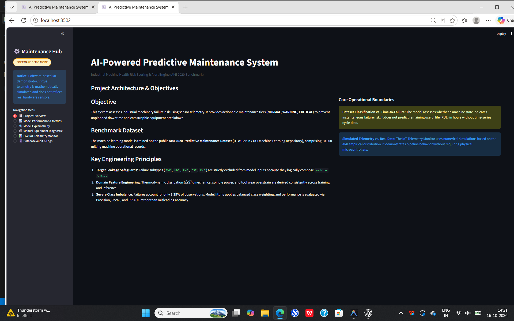
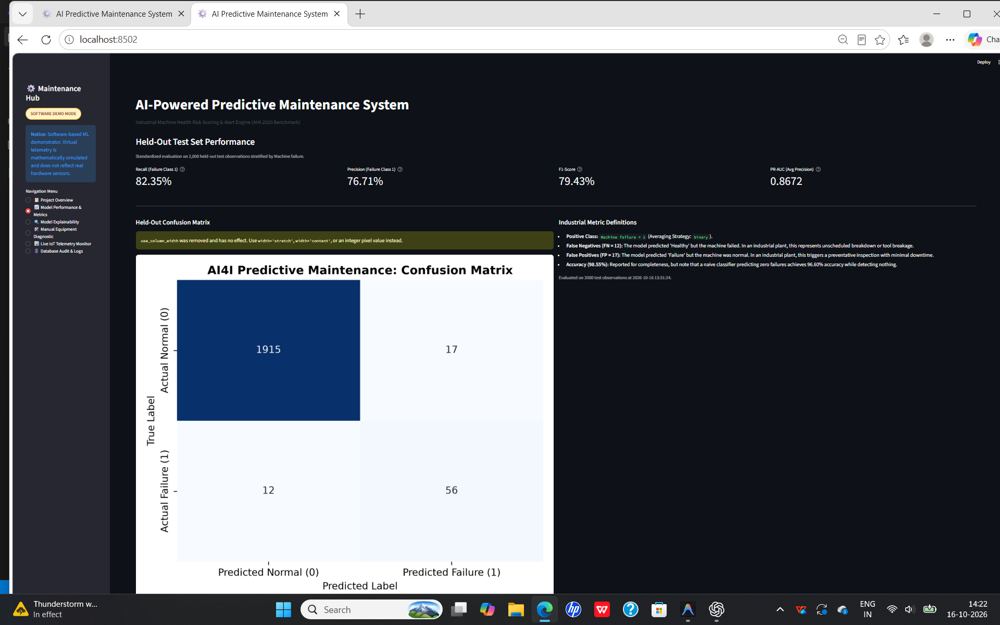
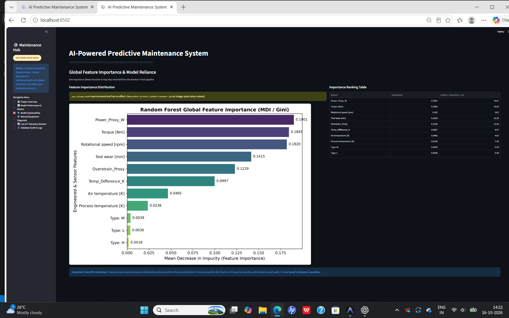
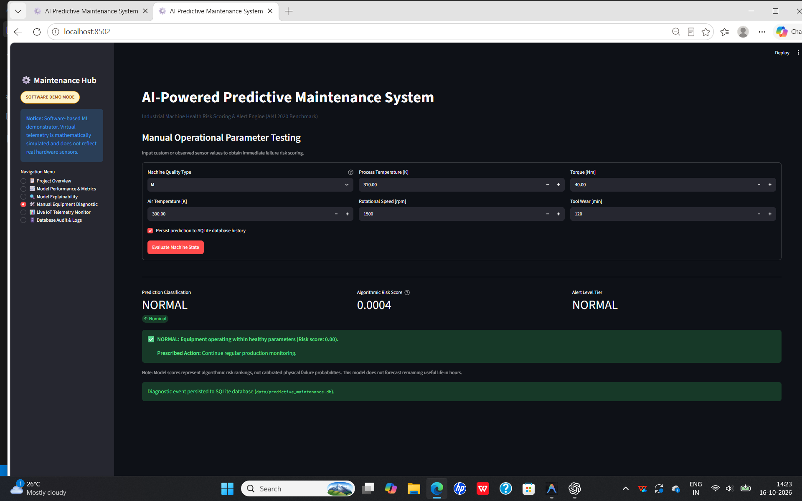
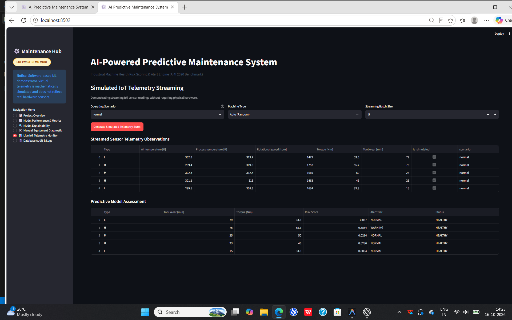
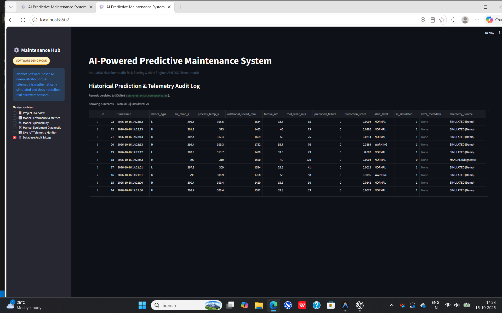

# AI-Powered Predictive Maintenance System for IoT Devices

[](https://www.python.org/)
[](https://opensource.org/licenses/MIT)
[](https://streamlit.io/)
[](https://www.sqlite.org/)
[](models/)
[](tests/)

An end-to-end, modular predictive maintenance machine learning system designed to assess industrial equipment failure risk from sensor telemetry. Trained and validated on the official **AI4I 2020 Predictive Maintenance Dataset** (10,000 observations, 3.39% failure rate), this system incorporates strict target leakage safeguards, physically grounded feature engineering, model explainability (Gini & Permutation importance), an automated multi-tier alert engine, an IoT telemetry simulator, and an interactive Streamlit dashboard.

> **Project Scope Notice:** This is a software-based machine learning portfolio project. Physical IoT sensors are not required. A built-in telemetry simulator generates synthetic sensor streams for demonstration; all synthetic readings are explicitly labeled as **simulated**.

---

## Interactive Dashboard Showcase

The system features an operational Streamlit dashboard providing real-time diagnostics, performance curves, explainability insights, telemetry simulation, and SQLite database audit logs:

| 1. Project Overview & System Scope | 2. Model Performance & Confusion Matrix |
| :---: | :---: |
|  |  |

| 3. Model Explainability (Gini & Permutation) | 4. Real-Time Manual Sensor Diagnostics |
| :---: | :---: |
|  |  |

| 5. Streaming IoT Telemetry Simulation | 6. SQLite Database Audit Trail |
| :---: | :---: |
|  |  |

---

## Performance Summary (Held-Out Test Set: 2,000 Observations)

The model was evaluated on a 20% held-out test split stratified by `Machine failure` with reproducible split indices (`models/train_test_split.json`):

| Metric | Score | Industrial Context / Interpretation |
| :--- | :---: | :--- |
| **Accuracy** | **98.55%** | Baseline naive accuracy (predicting 0 always) is 96.60%. Accuracy alone is uninformative. |
| **Recall (Failure Class 1)** | **82.35%** | **56 of 68 actual failures detected**. Critical in predictive maintenance to avoid catastrophic breakdown. |
| **Precision (Failure Class 1)** | **76.71%** | **56 of 73 predicted failures were genuine**. Minimizes unnecessary maintenance stops. |
| **F1-Score (Failure Class 1)** | **79.43%** | Harmonic mean balancing recall and precision under severe class imbalance (~3.39%). |
| **ROC-AUC** | **0.9845** | Exceptional class separability across decision thresholds. |
| **PR-AUC (Average Precision)**| **0.8672** | Precision-Recall AUC, the primary diagnostic benchmark for imbalanced problems. |

### Held-Out Confusion Matrix

| | Predicted Normal (`0`) | Predicted Failure (`1`) |
| :--- | :---: | :---: |
| **Actual Normal (`0`)** | **1,915 (TN)** | **17 (FP)** |
| **Actual Failure (`1`)** | **12 (FN)** | **56 (TP)** |

- **False Negatives (12):** Machine failed without warning. In industrial settings, this represents unscheduled downtime or damage.
- **False Positives (17):** Machine flagged for maintenance when healthy. In industrial settings, this triggers a preventative inspection with minimal operational disruption.

---

## Global Feature Importance & Explainability

Feature importance is extracted from the Random Forest tree ensemble (Mean Decrease in Impurity / Gini importance) and verified via Permutation Importance on held-out test observations:

| Rank | Feature Name | Description | Gini Importance | Relative Weight |
| :---: | :--- | :--- | :---: | :---: |
| 1 | `Power_Proxy_W` | Spindle mechanical power ($Torque \times Speed$) | 0.1901 | 19.01% |
| 2 | `Torque [Nm]` | Applied spindle torque | 0.1845 | 18.45% |
| 3 | `Rotational speed [rpm]` | Spindle rotational speed | 0.1820 | 18.20% |
| 4 | `Tool wear [min]` | Cumulative tool contact duration | 0.1415 | 14.15% |
| 5 | `Overstrain_Proxy` | Load-wear interaction ($Torque \times Tool Wear$) | 0.1229 | 12.29% |
| 6 | `Temp_Difference_K` | Thermal dissipation delta ($\Delta T$) | 0.0997 | 9.97% |
| 7 | `Air temperature [K]` | Ambient operational temperature | 0.0465 | 4.65% |
| 8 | `Process temperature [K]` | Machine internal process temperature | 0.0236 | 2.36% |
| 9 | `Type: M` | Medium-quality product variant | 0.0039 | 0.39% |
| 10 | `Type: L` | Low-quality product variant | 0.0036 | 0.36% |
| 11 | `Type: H` | High-quality product variant | 0.0018 | 0.18% |

> **Scientific Caution:** Feature importance measures mathematical reliance in the trained tree ensemble (split Gini impurity reduction). It is **not proof of physical causation**.

---

## Architecture Overview

```
AI-Predictive-Maintenance-IoT/
│
├── data/
│   ├── raw/
│   │   └── ai4i2020.csv     # Official UCI dataset (10,000 observations)
│   ├── processed/           # Cached or engineered datasets (reproducible)
│   ├── predictive_maintenance.db # SQLite persistence for predictions and alerts
│   └── README.md            # Dataset documentation and source instructions
│
├── notebooks/
│   └── README.md            # Guidelines for exploratory data analysis (EDA)
│
├── src/
│   ├── __init__.py          # Package initialization
│   ├── config.py            # Centralized paths, hyperparameters, and column definitions
│   ├── data_loader.py       # Safe data ingestion, schema validation, and dataset auditing
│   ├── preprocessing.py     # Leakage guards (drops TWF, HDF, PWF, OSF, RNF) and preprocessors
│   ├── feature_engineering.py # Thermodynamic and mechanical interaction features
│   ├── train_model.py       # Stratified training pipeline, dataset hashing, and Joblib serialization
│   ├── evaluate_model.py    # Held-out metrics evaluation, PR-AUC, confusion matrix
│   ├── explainability.py    # Global Gini and permutation feature importance analysis
│   ├── predictor.py         # Real-time and batch inference service
│   ├── simulator.py         # Synthetic IoT telemetry generator (labeled with is_simulated=True)
│   ├── alert_engine.py      # Multi-tier alert assignment (Normal, Warning, Critical)
│   ├── database.py          # SQLite persistence for prediction history and alerts
│   └── utils.py             # Logging, SHA-256 hashing, JSON serialization, and timestamp helpers
│
├── models/
│   ├── predictive_maintenance_rf.joblib # Serialized Scikit-Learn Pipeline
│   ├── train_test_split.json # Exact reproducible train/test indices and dataset hash
│   └── model_metadata.json  # Training parameters and dataset split metadata
│
├── outputs/
│   ├── metrics/
│   │   ├── evaluation_metrics.json # Full test set evaluation metrics
│   │   └── feature_importance.csv  # Ranked Gini and relative feature importance table
│   ├── plots/
│   │   ├── confusion_matrix.png    # High-resolution Seaborn confusion matrix heatmap
│   │   └── feature_importance.png  # Feature importance horizontal bar chart
│   └── predictions/
│
├── images/
│   └── .gitkeep
│
├── docs/
│   ├── architecture.md      # Detailed system architecture and data flows
│   ├── dataset.md           # Dataset analysis, features, class imbalance, and safeguards
│   └── implementation_plan.md # Development phases, evaluation results, and tracking
│
├── tests/
│   ├── __init__.py
│   ├── test_alert_engine.py
│   ├── test_config.py
│   ├── test_dashboard_integration.py
│   ├── test_data_loader.py
│   ├── test_database.py
│   ├── test_explainability.py
│   ├── test_feature_engineering.py
│   ├── test_predictor.py
│   ├── test_preprocessing.py
│   ├── test_provenance.py
│   ├── test_simulator.py
│   ├── test_split_validation.py
│   └── README.md
│
├── app.py                   # Interactive Streamlit dashboard entry point
├── main.py                  # Command-Line Interface (CLI) entry point
├── requirements.txt         # Project dependencies
├── .gitignore               # Version control ignore rules
├── .env.example             # Template for local environment variables
└── README.md                # Project documentation
```

---

## Machine Learning & Engineering Safeguards

1. **Target Leakage Safeguard:**  
   The failure-subtype columns (`TWF`, `HDF`, `PWF`, `OSF`, `RNF`) represent specific failure mechanisms that logically determine `Machine failure`. The preprocessing pipeline strictly removes these columns prior to training to ensure the model learns from sensor telemetry rather than target leakage.
2. **Domain-Grounded Feature Engineering:**  
   - $\Delta T = \text{Process Temperature} - \text{Air Temperature}$ (Thermal dissipation efficiency).
   - $P \propto \text{Torque} \times \text{Rotational Speed}$ (Mechanical spindle power).
   - $\text{Overstrain} = \text{Torque} \times \text{Tool Wear}$ (Interaction between contact degradation and load).
3. **Imbalance Handling:**  
   Stratified sampling (8,000 train / 2,000 test) preserves the 3.39% failure class balance across partitions. Class weighting (`class_weight="balanced"`) is applied within the `RandomForestClassifier`.
4. **Data Isolation:**  
   The `ColumnTransformer` (OneHotEncoder for `Type`, StandardScaler for numerical features) is fitted exclusively on training data inside a Scikit-Learn `Pipeline`.

---

## Quickstart Guide

### 1. Environment Setup

```bash
# Clone the repository
git clone https://github.com/your-username/AI-Predictive-Maintenance-IoT.git
cd AI-Predictive-Maintenance-IoT

# Install dependencies
pip install -r requirements.txt
```

### 2. Verify Dataset & Environment

```bash
python main.py check
```

### 3. Model Training, Evaluation & Explainability

```bash
# Initialize SQLite database
python main.py init-db

# Train the baseline Random Forest classifier (persists split indices & model artifact)
python main.py train

# Run model evaluation on the held-out test set
python main.py evaluate

# Generate feature importance tables and visual diagnostics
python main.py explain
```

### 4. Run CLI Predictions or Simulation

```bash
# Predict on a specific machine telemetry state
python main.py predict --type M --air-temp 300.0 --process-temp 310.0 --rpm 1500 --torque 40.0 --tool-wear 120 --log

# Stream 5 simulated sensor readings
python main.py simulate --scenario overstrain --stream 5
```

### 5. Launch the Streamlit Dashboard

```bash
streamlit run app.py
```
Access the dashboard in your browser at `http://localhost:8501`.

---

## Alert Tiers & Risk Score Interpretation

### Algorithmic Risk Scores
The `risk_score` output by `predict_single()` is the uncalibrated fraction of decision trees in the `RandomForestClassifier` voting for the positive failure class (`Machine failure = 1`). It provides an algorithmic ranking of failure risk, **not an empirical real-world failure probability**.

### Configurable Alert Tiers

| Alert Tier | Score Range | UI Indicator | Operational Guidance |
| :--- | :---: | :---: | :--- |
| **NORMAL** | `score < 0.30` | 🟢 Green | Machine telemetry within nominal bounds. Continue scheduled production. |
| **WARNING** | `0.30 <= score < 0.70` | 🟡 Amber | Elevated load, wear, or thermal stress detected. Schedule preventative inspection within upcoming shift. |
| **CRITICAL** | `score >= 0.70` | 🔴 Red | High algorithmic failure risk. Halt machine cycle immediately for spindle, bearing, and tool inspection. |

> **Industrial Notice:** Recommendations are illustrative guidelines designed for academic demonstration and do not constitute certified industrial safety directives.

---

## Automated Test Suite

Run the full pytest suite (48 unit and regression tests):

```bash
python -m pytest -v
```

### Test Coverage Highlights:
- **Split Validation (`tests/test_split_validation.py`):** Partition disjointness, duplicate indices, coverage integrity, index out-of-bounds, count agreement, and dataset SHA-256 hash mismatch detection.
- **Artifact Provenance (`tests/test_provenance.py`):** Cross-artifact consistency, dataset and model SHA-256 verification, and detection of stale/incompatible metadata.
- **Inference & Domain Bounds (`tests/test_predictor.py`):** Schema validation, missing keys, non-numeric values, NaN/Inf rejection, dynamic positive class index extraction, strictly positive Kelvin absolute temperature, non-negative speed/torque/wear limits, and score range $[0, 1]$ validation.
- **Alert Logic (`tests/test_alert_engine.py`):** Exact tier boundary conditions ($0.0$, $0.30$, $0.6999$, $0.70$, $1.0$), semantic separation from binary decision threshold, invalid score rejections, and synthetic telemetry flagging.
- **Database & Query Safety (`tests/test_database.py`):** Parameterized SQL queries, SQL injection resilience, connection lifecycle management, and empty-table handling.
- **Leakage Prevention (`tests/test_preprocessing.py`):** Strict exclusion of failure subtypes (`TWF`, `HDF`, `PWF`, `OSF`, `RNF`) and identifiers (`UDI`, `Product ID`).
- **Telemetry Simulator (`tests/test_simulator.py`):** Reproducible random seed control and mandatory `is_simulated = True` tagging.

---

## Limitations, Scientific Boundaries & Future Work

### Known Limitations
1. **State-Based Classification vs. Remaining Useful Life (RUL):**  
   The AI4I dataset contains instantaneous point-in-time sensor readings rather than continuous run-to-failure degradation histories. The model classifies whether an instantaneous telemetry state reflects failure risk; it does not estimate remaining operating hours until breakdown.
2. **Random Stratified Split Limitations:**  
   Random stratified splitting validates held-out predictive accuracy under identically distributed operational regimes. However, because observations originate from a single simulated continuous stream, random splitting does not prove temporal forecasting of future machine degradation or generalization to completely unseen machines with differing mechanical tolerances.
3. **Uncalibrated Model Scores:**  
   Random Forest voting fractions are monotonic risk indicators but are not mathematically calibrated probabilities. A score of 0.80 means 80% of trees voted for failure, not that the physical machine has an 80% failure rate under frequentist trials.
4. **Synthetic Data Boundaries:**  
   The built-in simulator approximates marginal feature distributions to demonstrate live dashboard streaming. It does not replicate the full joint distribution of real industrial machine wear. Synthetic telemetry is strictly quarantined from evaluation metrics and flagged in UI and database records.
5. **Demonstration Software:**  
   This is a software-only project designed for student portfolio demonstration and educational exploration. It is not certified for industrial safety-critical equipment operations.

### Future Work
- **Sequential Degradation Modeling:** Incorporate run-to-failure time-series datasets (such as NASA's C-MAPSS turbofan dataset) for validated Remaining Useful Life (RUL) regression.
- **Probability Calibration:** Apply Platt Scaling (logistic calibration) or Isotonic Regression to map ensemble vote fractions to calibrated empirical probabilities.
- **Local Model Explainability:** Implement SHAP (SHapley Additive exPlanations) `TreeExplainer` for per-prediction sensor contribution waterfall plots.
- **Containerization & CI/CD:** Package the application with Docker and implement automated GitHub Actions testing workflows.

---

## License

This project is licensed under the MIT License.
