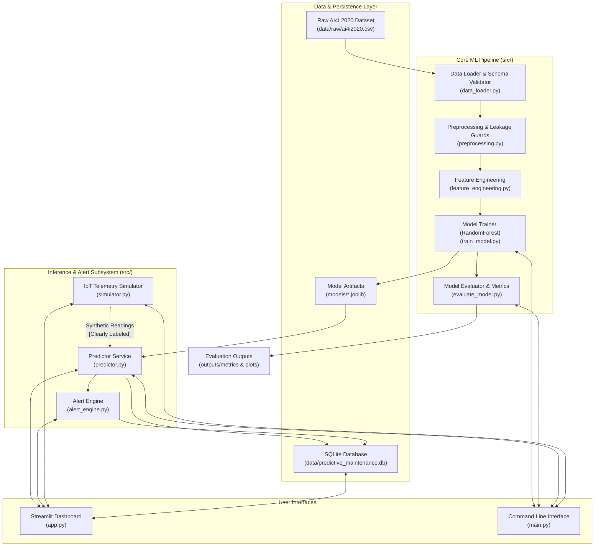

# System Architecture Documentation

## Executive Overview

The **AI-Powered Predictive Maintenance System for IoT Devices** is a modular machine learning application designed to assess equipment failure risk using machine telemetry data. The system combines:
1. An offline Machine Learning pipeline trained on historical sensor records (the UCI AI4I 2020 dataset).
2. A real-time inference engine and risk-scoring subsystem.
3. A multi-level rule-based alert engine.
4. An IoT telemetry simulator providing synthetic readings for demonstration without requiring physical hardware.
5. An interactive Streamlit dashboard and SQLite persistence layer.

---

## Architectural Data Flow

---

## Component Responsibilities

### 1. Data Loader & Schema Validator (`src/data_loader.py`)
- Ingests raw CSV data without modifying source files.
- Verifies column presence and data types.
- Provides informative error messages if columns are missing or altered.

### 2. Preprocessing & Leakage Safeguards (`src/preprocessing.py`)
- Isolates predictor variables from target labels (`Machine failure`).
- **Target Leakage Safeguard:** Explicitly removes `TWF`, `HDF`, `PWF`, `OSF`, and `RNF` failure-type labels prior to model training.
- Removes non-predictive operational IDs (`UDI`, `Product ID`).
- Performs stratified splitting to respect the ~3.39% minority class distribution.

### 3. Feature Engineering (`src/feature_engineering.py`)
- Computes physically grounded features:
  - **Temperature Difference:** $\Delta T = \text{Process Temperature} - \text{Air Temperature}$
  - **Mechanical Power Proxy:** $P \propto \text{Torque} \times \text{Rotational Speed}$
  - **Tool Wear Strain Factor:** Interaction between tool wear accumulated time and applied torque.
- Guarantees identical feature transformations are applied during both batch training and real-time inference.

### 4. Model Training & Evaluation (`src/train_model.py`, `src/evaluate_model.py`)
- Fits a baseline `RandomForestClassifier` with balanced class weights or hyperparameter configurations tuned for imbalanced data.
- Persists trained pipelines to `models/` using `joblib`.
- Evaluates models using Precision, Recall, F1-Score, and ROC-AUC rather than relying on misleading raw accuracy.
- Saves evaluation artifacts to `outputs/metrics/` and `outputs/plots/`.

### 5. Prediction Service (`src/predictor.py`)
- Loads serialized model artifacts with caching for fast inference.
- Accepts single or batch telemetry payloads, validates feature schema, and computes prediction labels and risk scores.

### 6. Alert Engine (`src/alert_engine.py`)
- Translates model risk scores into clear, actionable, informational alert tiers:
  - **NORMAL (Green):** Probability < 0.30
  - **WARNING (Amber):** 0.30 $\le$ Probability < 0.70
  - **CRITICAL (Red):** Probability $\ge$ 0.70
- Explicitly flags scores as **uncalibrated algorithmic scores** unless a calibration procedure (e.g., Platt scaling or Isotonic regression) is specifically implemented and validated.

### 7. Telemetry Simulator (`src/simulator.py`)
- Simulates realistic IoT sensor streams (temperature, rpm, torque, tool wear) based on the AI4I empirical distributions.
- **Important Distinction:** All synthetic outputs are tagged with `is_simulated = True` and displayed with clear "SIMULATED / DEMO" badges in the dashboard to ensure users and stakeholders understand no physical machine is attached.

### 8. Persistence Layer (`src/database.py`)
- Manages an embedded SQLite database (`data/predictive_maintenance.db`).
- Records prediction events, alert dispatches, and synthetic streaming logs using safe, parameterized SQL queries.

---

## Technical Constraints & Boundaries

- **Software-Only Environment:** All telemetry simulation is purely software-based.
- **No In-Place Modification:** The raw data directory `data/raw/` remains read-only for application code.
- **No Uncalibrated Horizon Claims:** The system assesses instantaneous machine health state; it does not claim to predict exact remaining useful life (RUL) in hours without time-series cycle data.
